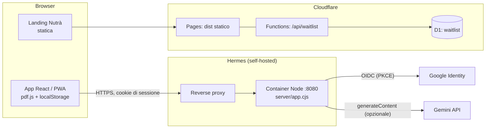

# NutriPro

Monorepo di due prodotti distinti che condividono solo il repository:

| Componente | Cartella | Cos'è | Stack | Dove gira |
| :--- | :--- | :--- | :--- | :--- |
| **App NutriPro** | `/` (root) | PWA per il paziente: importa il PDF Progeo Medical, mostra pasti, acqua, spesa, assistente | React 19 + Vite 8, backend Node 22 senza framework | Container Docker su Hermes (`nutriprobasta.jirachibot.eu`) |
| **Landing "Nutrà"** | `landing_page_nutripro/` | Sito vetrina B2B con waitlist per nutrizionisti tester | Vite 6 vanilla + GSAP/Lenis, Cloudflare Pages Functions + D1 | Cloudflare Pages (non ancora deployata) |

I due componenti **non condividono codice, dipendenze, build, runtime né deploy**.
Possono convivere nello stesso repo senza interferire (vedi [Convivenza](#convivenza-app-e-landing)).

---

## Indice

1. [Architettura](#architettura)
2. [Convivenza app e landing](#convivenza-app-e-landing)
3. [Struttura del repository](#struttura-del-repository)
4. [App NutriPro](#app-nutripro)
5. [Landing page](#landing-page-landing_page_nutripro)
6. [Configurazione (variabili d'ambiente)](#configurazione-variabili-dambiente)
7. [Sviluppo locale](#sviluppo-locale)
8. [Test](#test)
9. [CI/CD e deploy](#cicd-e-deploy)
10. [Sicurezza](#sicurezza)
11. [Documentazione di progetto](#documentazione-di-progetto)
12. [Stato e punti aperti](#stato-e-punti-aperti)

---

## Architettura



Principi di progetto dell'app:

- **Il piano alimentare non lascia il browser.** Il PDF è analizzato lato client con `pdf.js`; piani, spunte e acqua stanno in `localStorage`, una chiave per account (`diet_plan_archive:<Google sub>`). Il server conosce solo l'identità, mai il piano.
- **Il backend è minimale e stateful solo in memoria**: autenticazione Google, sessioni, un proxy verso Gemini, file statici. Nessun database.
- **Zero CDN**: JS, CSS, font e worker di pdf.js sono serviti dal backend (la CSP vieta origini esterne).
- **Login obbligatoria**: ogni route dell'app senza sessione valida reindirizza a `/login`.

## Convivenza app e landing

**Sì, convivono senza problemi**, perché sono isolati a ogni livello. Verificato sul codice:

| Aspetto | App (root) | Landing |
| :--- | :--- | :--- |
| `package.json` / lockfile | root | `landing_page_nutripro/` (propri) |
| Build | `vite build` → `dist/` (root) | `vite build` → `landing_page_nutripro/dist/` |
| Runtime | Node + Docker | Cloudflare Pages (statico + Functions) |
| Dominio previsto | `nutriprobasta.jirachibot.eu` | `nutra.pages.dev` (placeholder) o dominio proprio |
| Brand | NutriPro | Nutrà |
| Target | Paziente | Nutrizionista / dietista |
| CI | `nutripro-ci-deploy.yml` | **nessuna** (vedi [punti aperti](#stato-e-punti-aperti)) |

Perché non si disturbano:

- Il `Dockerfile` copia solo `index.html`, `vite.config.js`, `src/`, `public/`, `server/`. `.dockerignore` esclude tutto il resto: la landing **non entra nell'immagine**.
- Il `vite.config.js` e il `package.json` di root non vedono la cartella landing; `npm ci` e `npm test` in root non la toccano.
- La CI parte su push a `dev` e lavora dalla root.

**Ruolo della landing**: è l'acquisizione. Raccoglie candidature di professionisti per la fase di test (nome, email, ruolo, n. pazienti, consenso privacy) nella tabella D1 `waitlist`. Non fa login, non parla con l'app. Oggi il legame tra i due prodotti è solo di marketing: la landing promette ciò che l'app (lato paziente) già fa (menu del giorno, idratazione, lista della spesa, calcolatore).

**Cosa tenere d'occhio**: i due brand diversi (Nutrà vs NutriPro / "NutriPro Basta"), i lockfile separati, e il fatto che un'eventuale futura area professionisti (`/admin` nella landing) dovrà decidere se riusare l'auth Google dell'app o averne una propria.

## Struttura del repository

```
NutriPro/
├── index.html                 # Shell Vite dell'app (monta #root)
├── vite.config.js             # Vite + plugin React → dist/
├── package.json               # Dipendenze app (React, router, pdfjs, google-auth-library)
├── Dockerfile                 # Build multistadio (build Vite → runtime node:22-alpine)
├── compose.auth.yml           # Esecuzione standalone hardened
├── .env.example               # Modello configurazione (mai committare .env)
├── src/                       # Frontend React
│   ├── main.jsx               # Entry point
│   ├── App.jsx                # Router, Login, Protected (sessione), Home, Piani, Dettaglio
│   ├── components/ChatPage.jsx# Assistente Gemini (/chat)
│   ├── lib/dietEngine.mjs     # Parser PDF Progeo, conversioni, lista della spesa
│   ├── lib/planStore.mjs      # Archivio piani per account in localStorage
│   ├── lib/tracking.mjs       # Olio, quantità, step tracking
│   └── *.css
├── public/                    # manifest.webmanifest, icon-512.png (PWA)
├── server/
│   ├── index.cjs              # Bootstrap + graceful shutdown (SIGINT/SIGTERM)
│   ├── app.cjs                # HTTP server: config, auth OIDC, sessioni, CSP, routing, statici
│   └── gemini.cjs             # Servizio chat Gemini (validazione, rate limit, timeout)
├── tests/                     # Unit/integration (*.test.cjs) e browser (*.e2e.cjs)
├── .github/workflows/nutripro-ci-deploy.yml
├── landing_page_nutripro/     # Prodotto separato (vedi sezione dedicata)
├── .wayfinder/ + WAYFINDER.md # Mappa decisionale e ticket WF-001…WF-020
├── CONTEXT.md                 # Glossario di dominio
└── HANDOFF.md                 # Diario operativo di sessione (storico, 800+ righe)
```

---

## App NutriPro

### Frontend

- **Routing** (React Router 7): `/login`, `/` (Home), `/plans`, `/plans/:id`, `/chat`, `/settings`.
- **`Protected`** verifica `/api/session` ogni 60 s e a ogni ritorno in primo piano; blocca la UI quando la pagina è nascosta; espelle l'utente su scadenza o cambio account.
- **PDF**: `parseProgeoPdf` (pdf.js) → struttura per giorno/pasto/alimento, con alternative esplicite, ricette e tabella "Unità di misura" del PDF che prevale sui coefficienti generici.
- **Archivio** (`planStore`): un piano attivo alla volta (o nessuno), piani inattivi consultabili, "sostituzione" distruttiva con doppia conferma. Nessuna sincronizzazione fra dispositivi, nessun PDF originale conservato.
- **Interfaccia**: selettore giorni, card pasti con spunte, water tracker (obiettivo configurabile), calcolatore crudo/cotto, lista della spesa (copia, condividi, `.txt`), layout mobile con tab bar.
- **PWA**: `manifest.webmanifest` + icona. Nessuna cache offline: login e verifica sessione richiedono rete.

### Motore di conversione (dettaglio)

Regole principali applicate al parsing (le quantità restano indicative: confrontare sempre col PDF):

| Alimento | Formato PDF | Conversione |
| :--- | :--- | :--- |
| Cereali (riso, farro, orzo) | cucchiai | 1 cucchiaio = 20 g |
| Couscous | cucchiai | 1 cucchiaio = 10 g |
| Olio EVO | cucchiaini | 1 cucchiaino = 4 g |
| Legumi secchi | cucchiai | 20 g/cucchiaio × 2,5 → peso cotto sgocciolato |
| Piselli freschi | cucchiai | 20 g/cucchiaio |
| Latte | bicchiere | 200 g/ml |
| Fiocchi | bicchiere | 40 g |
| Acqua | bicchiere | 200 ml |

I glifi `½` sono normalizzati; le intestazioni di pasto sono riconosciute solo a riga intera (così "Olio extra vergine" non diventa il pasto "extra"). Test dedicati in `tests/shopping-list.test.cjs`.

### Backend (`server/`)

Server `http` di Node senza framework. Route:

| Route | Metodo | Auth | Scopo |
| :--- | :--- | :--- | :--- |
| `/healthz` | GET | no | Health check (usato dal `HEALTHCHECK` Docker) |
| `/deploy-version.txt` | GET/HEAD | no | SHA del deploy (`NUTRIPRO_SHA`) |
| `/auth/status` | GET | no | Login configurato? |
| `/auth/google` | GET | no | Avvia OIDC (state, nonce, PKCE S256), rate limit |
| `/auth/google/callback` | GET | flusso | Scambio codice, verifica ID token, crea sessione |
| `/api/session` | GET | sì | Identità, token CSRF, scadenza |
| `/auth/logout` | POST | sì + CSRF | Revoca sessione, `Clear-Site-Data: "cache"` |
| `/api/chat/status` | GET | sì | Stato assistente |
| `/api/chat` | POST | sì + CSRF + Origin | Messaggio a Gemini |
| `/`, `/plans`, `/chat`, `/settings`, `/plans/:id` | GET | sì | Shell SPA (senza sessione → `/login`) |
| `/assets/*`, `/icon-512.png`, `/manifest.webmanifest` | GET | no | Statici da allowlist |

**Sessioni**: cookie firmato HMAC-SHA256 (`__Host-nutripro_session` in HTTPS), HttpOnly, durata di default 90 giorni con rinnovo all'uso (max 180). Con `SESSION_SECRET` sopravvivono ai riavvii; senza, ogni restart disconnette tutti (warning a log). La revoca al logout è tenuta in memoria.

**Assistente Gemini** (`gemini.cjs`): modello unico ammesso `gemini-3.5-flash-lite`, **spento di default**. Per attivarlo servono insieme `GEMINI_ENABLED=true`, `GEMINI_API_KEY` e `GEMINI_ACCESS_MODE` (`local-dev` solo su localhost; `paid-services` è la decisione esplicita richiesta per client pubblici in SEE). Nessun piano né dato dell'account viene inviato a Google. Limiti: 5 richieste/min e 30/giorno per account, 120/giorno globali, 4 concorrenti, timeout 20 s, nessun retry; input ≤ 2000 caratteri, cronologia ≤ 20 messaggi / 24000 caratteri. Contatori in memoria (reset al riavvio). Stato: WF-010 aperto, mai verificato con provider reale.

### Container

`Dockerfile` multistadio: stadio build (`npm ci --include=dev`, `vite build`) → stadio runtime `node:22-alpine`, solo dipendenze di produzione, utente `node`, porta 8080, `HEALTHCHECK` su `/healthz`. `compose.auth.yml` (riferimento standalone) aggiunge: bind su `127.0.0.1`, filesystem read-only, `cap_drop: ALL`, `no-new-privileges`, tmpfs su `/tmp`, 128 MB RAM, 0.25 CPU.

---

## Landing page (`landing_page_nutripro/`)

Sito vetrina "Nutrà" per reclutare nutrizionisti tester.

- **Frontend**: Vite 6, JavaScript vanilla a componenti (`src/components/`), GSAP + Lenis per animazioni e scroll, storytelling in `src/story/`, stili CSS divisi per sezione (`src/styles/`). Due pagine: `index.html` e `privacy/index.html`.
- **Config unica**: `src/config.js` (nome brand, `SITE_URL`, `CONTACT_EMAIL`, endpoint, SEO). Il plugin `brand-html` in `vite.config.js` sostituisce i segnaposto `%BRAND%`, `%SEO_TITLE%`, … nell'HTML già a build time (SEO e no-JS ok).
- **Backend serverless** (Cloudflare Pages Functions):
  - `POST /api/waitlist`: valida (nome, email, ruolo, n. pazienti ≤ 10000, consenso), controlla `Origin`, honeypot anti-spam (campo `website`), supporta JSON e form classico (fallback no-JS), insert idempotente in D1 (`ON CONFLICT(email) DO NOTHING`, così non rivela chi è iscritto).
  - `/admin/*`: oggi risponde sempre 403 (area riservata non ancora realizzata).
- **Database**: D1 `nutra-waitlist`, migrazione `migrations/0001_create_waitlist.sql`.
- **Comandi** (dentro `landing_page_nutripro/`):

```powershell
npm install
npm run dev                # Vite in sviluppo (genera prima il favicon)
npm run build              # → dist/
npm run db:migrate:local   # applica le migrazioni D1 in locale
npm run pages:dev          # build + wrangler pages dev su :8788 (con Functions e D1 locale)
```

> **Prima di pubblicarla** va fatto: `npx wrangler d1 create nutra-waitlist` e sostituire `database_id` (oggi `0000…`) in `wrangler.toml`; applicare le migrazioni in remoto; impostare `SITE_URL` e `CONTACT_EMAIL` reali in `src/config.js`; creare il progetto Pages.

---

## Configurazione (variabili d'ambiente)

Solo app. Copiare `.env.example` in `.env` (ignorato da git). Mai committare valori reali.

| Variabile | Obbligatoria | Default | Note |
| :--- | :--- | :--- | :--- |
| `APP_ORIGIN` | sì in prod | `http://localhost:8080` | Origine assoluta senza path; HTTPS obbligatorio fuori da localhost. Base del redirect OAuth e dei controlli Origin. |
| `PORT` | no | `8080` | |
| `GOOGLE_CLIENT_ID` / `GOOGLE_CLIENT_SECRET` | sì per il login | vuoto | Vanno impostate **entrambe**; client OAuth "Web application". Senza: accesso chiuso. |
| `ALLOWED_EMAILS` | no | vuoto (tutti) | Allowlist di email Google verificate, separate da virgola. |
| `SESSION_TTL_SECONDS` | no | `7776000` (90 gg) | 60 s … 180 gg, rinnovata all'uso. |
| `SESSION_SECRET` | consigliata | casuale a ogni avvio | ≥ 32 caratteri. Senza, i restart disconnettono tutti. Cambiarla disconnette tutti. |
| `TRUST_PROXY` | no | `false` | `true` solo dietro il proxy privato che sovrascrive `X-Real-IP`. |
| `NUTRIPRO_SHA` | no | `unknown` | SHA a 40 hex esposto da `/deploy-version.txt`; impostato dal deploy. |
| `GEMINI_ENABLED` | no | `false` | |
| `GEMINI_API_KEY` | se attivo | vuoto | Solo server, mai nel client. |
| `GEMINI_MODEL` | no | `gemini-3.5-flash-lite` | Qualsiasi altro valore → `unsupported_model`. |
| `GEMINI_ACCESS_MODE` | se attivo | vuoto | `local-dev` o `paid-services`. |

OAuth: registrare il redirect `{APP_ORIGIN}/auth/google/callback`. In produzione `https://nutriprobasta.jirachibot.eu/auth/google/callback`. Con il progetto Google in *Testing*, aggiungere gli account di test nella schermata Audience.

## Sviluppo locale

Requisiti: Node ≥ 22.14.

```powershell
npm ci --ignore-scripts
Copy-Item .env.example .env      # poi compilare le credenziali Google
npm start                        # build + server su http://localhost:8080
npm run dev                      # (altro terminale) rebuild in watch; ricaricare il browser
```

Un server statico non basta: la login richiede il backend. Senza credenziali la pagina di login segnala "accesso non disponibile" e la home resta chiusa.

Docker standalone: `docker compose -f compose.auth.yml up --build -d`.

## Test

```powershell
npm test               # build + unit/integration (53 test: spesa, auth, piani, gemini, chat, settings)
npm run test:browser   # E2E Playwright (login, spesa, piani, import PDF, chat, mobile, settings)
```

- I test di login simulano il provider Google ma usano server e cookie reali; un test a parte verifica firme RSA con la libreria Google. La verifica con un progetto Google reale resta necessaria prima dell'attivazione.
- I test browser leggono `PLAYWRIGHT_MODULE` (percorso del modulo Playwright, installato fuori dal repo; la CI usa `playwright@1.61.1`).
- `tests/progeo-pdf.e2e.cjs` richiede un PDF privato (`REAL_PROGEO_PDF`), **non** è in CI: da eseguire a mano prima di toccare il parser.
- La landing non ha test.

## CI/CD e deploy

Workflow `.github/workflows/nutripro-ci-deploy.yml`, su **push a `dev`**:

1. **test**: `npm ci` → `npm test` → installa Playwright/Chromium → `npm run test:browser`. Azioni fissate per SHA.
2. **deploy** (solo se i test passano, solo su `dev` del repo ufficiale, environment `nutripro-deploy`): verifica che lo SHA appartenga a `dev`, poi lancia `deploy-nutripro.yml` nel repo `Thegoldendice/JirachiBotOrchestrator`, che gira sul runner self-hosted di Hermes, prende un lock host-wide e rifiuta di sostituire un commit più recente.

Requisiti: secret `ORCHESTRATOR_DISPATCH_TOKEN` (PAT fine-grained limitato al repo Orchestrator, solo *Actions: read and write*). Credenziali di produzione fuori dal clone: `/home/hermes/.config/nutripro/auth.env`. Il proxy deve puntare al container Node sulla porta 8080 (il vecchio nginx sulla 80 non è compatibile).

**Flusso di branch**: si lavora su `dev` (che deploya); `main` riceve `dev` con fast-forward quando si vuole fissare una release. Il push su `main` **non** deploya.

La landing si deploya a parte con Wrangler/Cloudflare Pages (oggi manuale, vedi [punti aperti](#stato-e-punti-aperti)).

## Sicurezza

- **OIDC hardened**: state, nonce, PKCE S256, flusso monouso, verifica di firma/aud/iss/exp/`email_verified`, `sub` come chiave identità, rate limit per tentativi di login e callback concorrenti.
- **Cookie** `__Host-` (Secure, HttpOnly, Path=/) in HTTPS; CSRF token per le POST + controllo `Origin`.
- **CSP stretta**: `default-src 'self'`, niente script/stili inline né origini esterne, `object-src 'none'`, `frame-ancestors 'self'`. Header aggiuntivi: `nosniff`, `Referrer-Policy: no-referrer`, `Permissions-Policy` che nega camera/microfono/geolocalizzazione, `Cache-Control: no-store`.
- **Privacy dati**: il piano non viene mai inviato al server né a Google; `localStorage` è leggibile da chiunque usi il profilo del browser (limite noto, documentato).
- **Segreti**: solo via env, mai nel client né nel repo; log senza token/codici/dati personali.
- **Container** non-root, read-only, senza capability.

## Documentazione di progetto

| File | Contenuto |
| :--- | :--- |
| [CONTEXT.md](CONTEXT.md) | Glossario di dominio (Piano attivo/inattivo, Sostituzione, Account Google, Sessione, …) |
| [WAYFINDER.md](WAYFINDER.md) + [.wayfinder/](.wayfinder/TRACKER.md) | Mappa decisionale e 20 ticket (WF-001…WF-020): login, archivio, Gemini, settaggi, tracking, PWA |
| [HANDOFF.md](HANDOFF.md) | Diario cronologico delle sessioni e dei rilasci; fonte storica, le sezioni più recenti prevalgono |

## Stato e punti aperti

- **Landing**: `database_id` D1 placeholder, `SITE_URL`/`CONTACT_EMAIL` placeholder, `/admin` chiuso, nessuna CI/deploy automatico, nessun test. Decisione brand Nutrà vs NutriPro da prendere.
- **Gemini (WF-010)**: aperto. Ultimo run CI: test ok ma richiesta di deploy fallita (causa non diagnosticata, vedi HANDOFF). Nessuna verifica con provider reale; attivazione pubblica richiede decisione sul tier a pagamento.
- **CI**: la condizione del job deploy è vincolata a `M4nu0w2/M4nu0w2.github.io`; il PDF reale non è coperto.
- **Dati**: nessun backup/sincronizzazione; perdere il browser significa perdere i piani.
- **Sessioni**: revoca e rate limit in memoria, non scalano oltre una singola istanza.

## Licenza

MIT.
